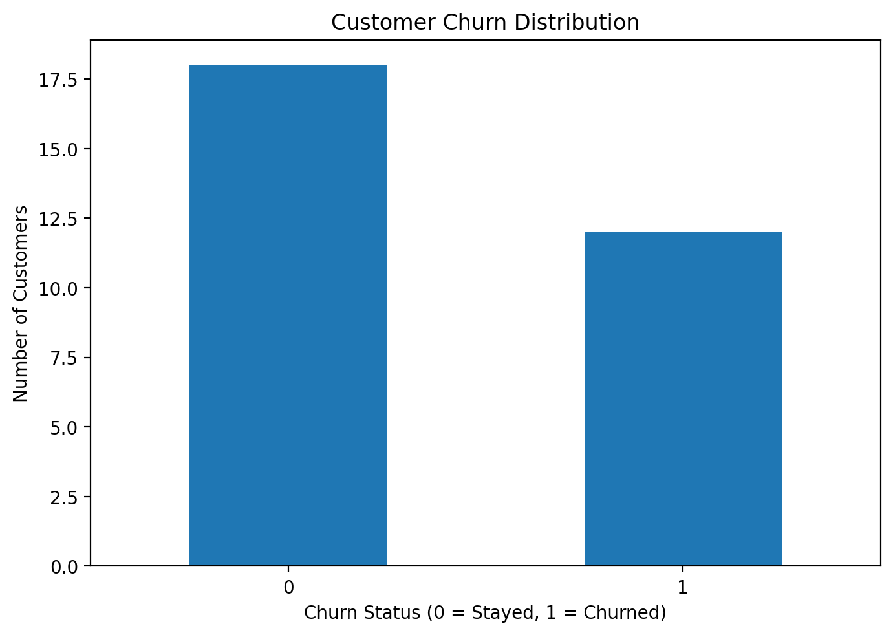
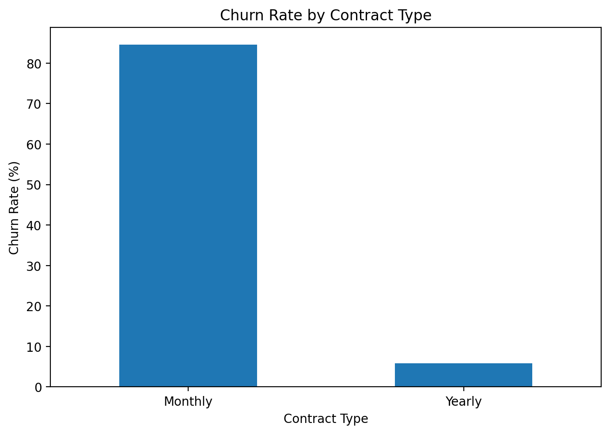
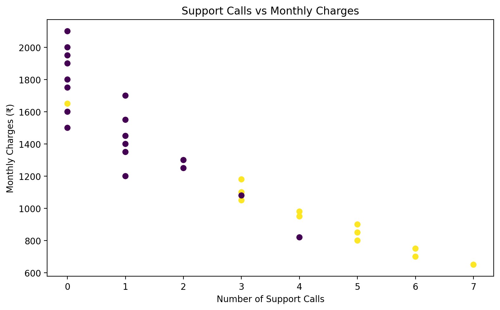

# Customer Churn Prediction

## Project Overview

This project uses Python and machine learning to analyze customer behavior and predict whether a customer is likely to leave a service.

The analysis examines factors such as customer tenure, monthly charges, support interactions, and contract type to identify patterns associated with customer churn.

A Logistic Regression classification model is used to predict customer churn and evaluate its performance.

## Objectives

- Analyze customer behavior and churn patterns
- Identify factors associated with customer churn
- Compare churn rates across contract types
- Analyze the relationship between support calls and customer churn
- Visualize customer churn patterns
- Build a machine learning classification model
- Predict churn probability for new customers
- Export predictions for further analysis

## Technologies Used

- Python
- Pandas
- Matplotlib
- Scikit-learn
- Machine Learning
- Git
- GitHub

## Dataset

The dataset contains **30 customer records**.

Each customer record includes:

- Customer ID
- Age
- Tenure in months
- Monthly charges
- Number of support calls
- Contract type
- Churn status

The `Churn` column represents the target variable:

- `0` — Customer stayed
- `1` — Customer churned

## Data Analysis

The project analyzes:

- Total number of customers
- Number of customers who churned
- Overall churn rate
- Churn by contract type
- Average support calls by churn status
- Average monthly charges by churn status
- Potential high-risk customers

## Machine Learning

A **Logistic Regression** model is used to predict customer churn.

### Machine Learning Workflow

1. Separate features and target variable
2. Remove the customer ID from the predictive features
3. Encode the categorical contract variable
4. Split the dataset into training and testing sets
5. Train the Logistic Regression model
6. Generate predictions
7. Evaluate model accuracy
8. Generate churn predictions for new customers

## Visualizations

The project generates three visualizations.

### 1. Customer Churn Distribution

Shows the number of customers who stayed versus those who churned.



### 2. Churn Rate by Contract Type

Compares the churn rate between monthly and yearly contracts.



### 3. Support Calls vs Monthly Charges

Visualizes the relationship between support interactions and monthly charges, while distinguishing customer churn status.



## Model Evaluation

The model is evaluated using:

- Accuracy
- Precision
- Recall
- F1-score
- Confusion Matrix

The model's accuracy is displayed automatically when the program is executed.

## Customer Predictions

The trained model is also used to predict churn for new customers.

For each new customer, the program provides:

- Predicted churn status
- Churn probability

The predictions are exported to:

`churn_predictions.csv`

## Key Insights

The analysis can be used to identify customers who may be at higher risk of leaving.

Potential risk indicators include:

- Monthly contracts
- Higher numbers of support calls
- Shorter customer tenure
- Higher monthly charges

These insights can help businesses identify customers who may benefit from targeted retention strategies.

## Project Structure

```text
customer-churn-prediction/
│
├── churn_analysis.py
├── customers_cleaned.csv
├── churn_predictions.csv
├── churn_distribution.png
├── churn_by_contract.png
├── support_vs_charges.png
└── README.md
```

## Key Skills Demonstrated

- Python programming
- Pandas data analysis
- Data preprocessing
- Exploratory data analysis
- Data visualization
- Categorical feature encoding
- Machine learning
- Logistic Regression
- Classification
- Model evaluation
- Prediction
- CSV file handling
- Analytical interpretation

## Conclusion

This project demonstrates an end-to-end machine learning workflow for customer churn prediction.

The project combines data analysis, visualization, preprocessing, classification, and prediction to identify customers who may be at risk of leaving a service.

It provides a foundation for more advanced projects involving customer segmentation, predictive analytics, recommendation systems, and business intelligence.
